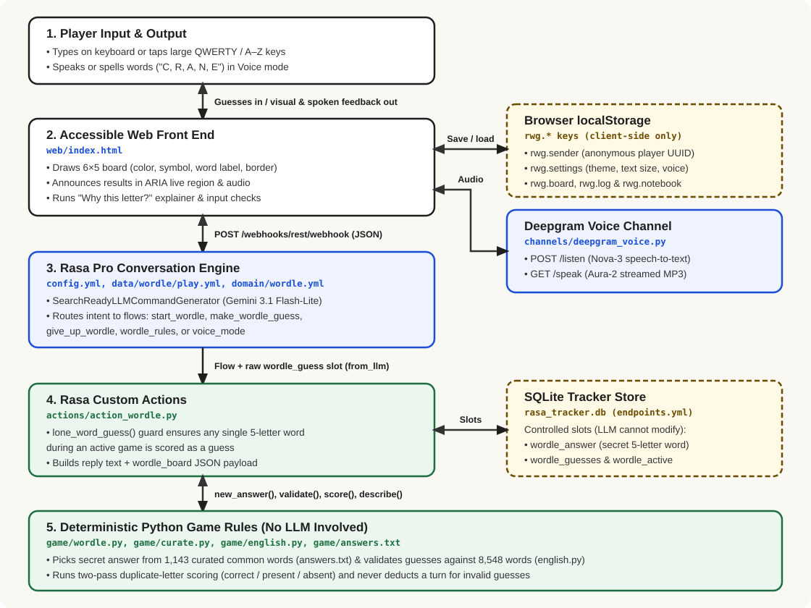
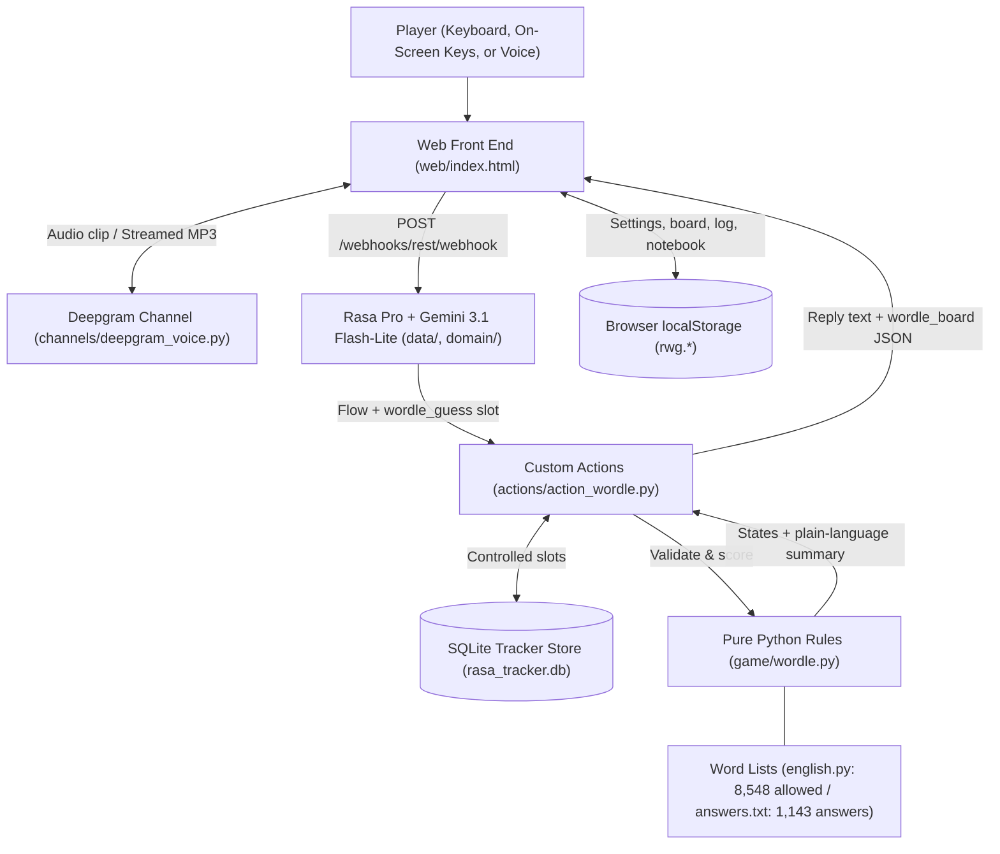

# M1: Design Concept and Data-Flow Diagram

## Design concept

**Lexi's Word Game** is an accessible, low-pressure Wordle-style puzzle built for older adults (age 60+). Standard daily word games assume players can tell red/green/yellow apart, read small text, type accurately on a cramped keyboard, hold letter elimination rules in working memory, and accept a single daily puzzle with streak counters. Lexi removes those barriers while keeping the familiar 5-letter, 6-guess puzzle loop:

1. **Feedback that never depends on color:** Every scored tile shows four cues at once—a fill color, a symbol (`✓`, `●`, `✕`), a short word directly on the tile (`Right`, `In word`, `Not in`), and a distinct border (`solid`, `dashed`, or `dotted` with strikethrough text)—and players can switch between **Colors, symbols, and words**, **Symbols and words only** (zero hue), and **High contrast, dark background**.
2. **Multiple forgiving ways to play:** Players can type on a physical keyboard anywhere on the page, tap large ($\ge 44 \times 44\text{ px}$) on-screen keys in **QWERTY** or **Alphabetical (A to Z)** order, press **Speak** to say or spell a word (`"C, R, A, N, E"`), or turn on hands-free **Voice mode** so Lexi reads each reply aloud and listens automatically after she finishes speaking.
3. **Zero time pressure and kind error handling:** There is no timer and no streak counter. Words that are too short, too long, contain non-letters, were already tried, or are not in `english.py` never cost a guess. If a player gets stuck, **I give up** (after a confirmation prompt) kindly reveals the word and offers a fresh game.
4. **Cognitive and memory support:** Selecting any scored tile opens the **"Why this letter?"** explainer (in text and speech, including why a second copy of a repeated letter is marked `Not in`). A private **Letter notebook** and the full conversation log stay visible beside the board, and the secret answers are curated down to **1,143 common, everyday words** (`game/answers.txt`) from the 8,548 five-letter words in `english.py`.
5. **Deterministic rules, conversational AI:** Rasa Pro (with Gemini 3.1 Flash-Lite) interprets what the player meant in natural language, while pure Python (`game/wordle.py` and `actions/action_wordle.py`) picks the secret word, checks guesses against `english.py`, and scores letters. The language model never scores guesses or alters game state.

## Data-flow diagram



The main path a guess or voice turn takes through the system:

```
Player (types on keyboard, taps on-screen keys, or speaks into microphone)
   │
   ▼
Web page (web/index.html) ──────────► Deepgram voice routes (/webhooks/deepgram/*)
   │  draws the board, keyboard,         • POST /listen (Nova-3 speech-to-text)
   │  notebook, and settings             • GET  /speak  (Aura-2 streamed MP3 audio)
   │
   │  POST /webhooks/rest/webhook  ({ sender, message })
   ▼
Rasa Pro (config.yml, data/wordle/play.yml, domain/wordle.yml)
   │  SearchReadyLLMCommandGenerator (Gemini 3.1 Flash-Lite) picks the flow
   │  (start_wordle, make_wordle_guess, give_up_wordle, wordle_rules, voice_mode)
   │  and fills the raw wordle_guess slot
   ▼
Custom actions (actions/action_wordle.py)
   │  lone_word_guess() guard ensures a single 5-letter word during an active
   │  game is always scored as a guess; builds the wordle_board JSON payload
   ▼
Game rules (game/wordle.py + game/english.py + game/answers.txt)
   │  deterministic Python: new_answer(), validate(), two-pass score(),
   │  describe(), keyboard_state(), and end_message() — with no LLM involved
   ▼
Reply text + wordle_board JSON ──► Web page ──► Player (board tiles, live region, & audio)
```



## What is stored where

State is split cleanly between the Rasa server (authoritative game state) and the player's browser (display preferences, scratch notes, and cached view):

| Location | Key / Slot | Type & control | What it stores |
|---|---|---|---|
| **Rasa tracker store** (`rasa_tracker.db` via SQLite in `endpoints.yml`) | `wordle_answer` | `text` (`controlled`) | The secret 5-letter word for the active game. Set only by `ActionStartWordle`; never exposed to the client while `status == "playing"`. |
| **Rasa tracker store** | `wordle_guesses` | `list` (`controlled`) | Ordered list of valid 5-letter guesses accepted so far in the current game. Invalid or duplicate guesses are not added. |
| **Rasa tracker store** | `wordle_active` | `bool` (`controlled`) | `True` while a game is in progress; set to `False` when the player wins, uses all 6 guesses, or confirms **I give up**. |
| **Rasa tracker store** | `wordle_guess` | `text` (`from_llm`) | The raw word extracted from the player's message by the LLM for the current turn, reset to `None` immediately after `score_guess()` runs. |
| **Browser `localStorage`** (`web/index.html`) | `rwg.sender` | Random UUID string | Anonymous player ID (`player-<uuid>`) used as the Rasa `sender` so the player's game persists across page reloads with zero personal data. |
| **Browser `localStorage`** | `rwg.board` | JSON object | Latest `wordle_board` payload (`rows`, `max_guesses`, `guesses_left`, `keyboard`, `status`, and `answer` after game end) for instant board rendering on reload. |
| **Browser `localStorage`** | `rwg.settings` | JSON object | Persistent user preferences: `style` (`standard`, `mono`, `dark`), `size` (`normal`, `large`, `xlarge`), `layout` (`qwerty`, `abc`), `read` (read-aloud), `motion` (reduced animation), `voice` (hands-free voice mode), and `server` URL. |
| **Browser `localStorage`** | `rwg.notebook` | String | The player's private scratch notes in **My letter notebook** (never sent to the server). |
| **Browser `localStorage`** | `rwg.log` & `rwg.introSeen` | JSON array / Bool | Up to 60 recent chat messages so the conversation history survives reloads, plus whether the first-visit **How to play** dialog has been shown. |
